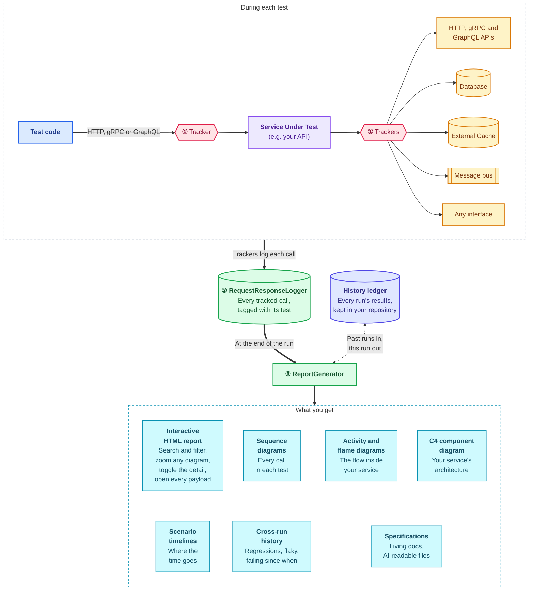

[](https://www.nuget.org/packages/Kronikol)
[](https://www.nuget.org/packages/Kronikol)
[](https://github.com/lemonlion/Kronikol/actions/workflows/ci.yml)


<a name="top"></a>

#  Kronikol

**[See a live report](https://lemonlion.github.io/BreakfastProvider/)** from a sample service's test run.

*Formerly **TestTrackingDiagrams** — the same project, renamed in 3.0.0 (May 2026). The `TestTrackingDiagrams.*` NuGet packages are the old identity and are no longer updated; install `Kronikol.*`.*

Automatically generates [rich interactive HTML reports](https://lemonlion.github.io/BreakfastProvider/) with PlantUML sequence, activity and component diagrams, with timeline visualizations from your integration/component test HTTP traffic (real or faked) and telemetry.

Kronikol tracks every call between your test, your Service Under Test and its dependencies, and turns them into:

- **Sequence diagrams** for every test: HTTP, gRPC and GraphQL calls, database queries (Cosmos DB, SQL through EF Core and more), cache commands, events and messages, and calls to any interface.
- **Activity and flame diagrams** of the flow inside your service, a **C4 component diagram** of the whole service, and **scenario timelines** that show where the time goes.
- **Cross-run history**: a ledger kept in your repository says whether each failure is a regression, flaky, or failing since a particular run.
- **Living documentation**: specifications in YAML, readable by people and by AI tools.

In the report:

- **Search everything**: payloads, headers, SQL and diagram text, not just scenario names.
- **A table per data set**: InlineData, MemberData, TestCase and their equivalents in xUnit, NUnit, TUnit, ReqNRoll and LightBDD become clickable tables, each row showing the diagrams for its inputs.
- **Detail on demand**: collapse, truncate and toggle what each diagram shows, and switch payloads between JSON and YAML so multi-line strings like SQL keep their line breaks.
- **BDD steps in place**: Gherkin data tables and doc strings appear inside the diagram where their step runs.
- **Assertions in plain English** from FluentAssertions, AwesomeAssertions, Shouldly and TUnit.

---

## Table of Contents

- [Example Output](#example-output)
- [How It Works](#how-it-works)
- [Use Cases](#use-cases)
- [Deterministic vs AI-Generated Diagrams](#deterministic-vs-ai)
- [Supported Frameworks & NuGet Packages](#supported-frameworks)
- [Documentation](#documentation)

---

## <a name="example-output"></a>Example Output [↑](#top)

**This is just a screenshot of a generated diagram - for a full, rich, interactive example, click on it to see the generated [BreakfastProvider diagrams](https://lemonlion.github.io/BreakfastProvider/) in the [BreakfastProvider](https://github.com/lemonlion/BreakfastProvider) project.** 

[](https://lemonlion.github.io/BreakfastProvider/reports/reqnroll/TestRunReport.html#scenario-a-valid-pancake-request-should-return-a-fresh-batch)

Each test that uses tracked dependencies automatically produces a sequence diagram (with matching PlantUML) showing the full request/response flow between services.

> **Tip:** You can visually separate the setup (arrange) phase from the action phase using the [`SeparateSetup`](https://github.com/lemonlion/Kronikol/wiki/Diagram-Customisation#setup-separation) flag.

---

## <a name="how-it-works"></a>How It Works [↑](#top)



1. **Intercept** — Each type of dependency has a dedicated tracking mechanism that logs interactions to the same in-memory store:

    | Dependency | Tracking mechanism | How it works |
    |---|---|---|
    | **HTTP** | `TestTrackingMessageHandler` | `DelegatingHandler` in the HTTP pipeline — logs method, URI, headers, body, status code, and names GraphQL queries and mutations from the body |
    | **gRPC** | `GrpcTrackingInterceptor` | gRPC `Interceptor` on the client channel — logs unary and streaming calls with their service and method names |
    | **Azure Cosmos DB** | `CosmosTrackingMessageHandler` | `DelegatingHandler` injected via `CosmosClientOptions.HttpClientFactory` — classifies operations (Query, Create, Upsert, etc.) with configurable verbosity |
    | **SQL (EF Core)** | `SqlTrackingInterceptor` | `DbCommandInterceptor` — intercepts SQL commands from any relational provider (SQL Server, PostgreSQL, MySQL, SQLite, etc.) |
    | **Redis** | `RedisTrackingDatabase` | `DispatchProxy` wrapping `IDatabase` — tracks GET, SET, HSET, LPUSH, PUBLISH, etc. with cache hit/miss status |
    | **Any interface** | `TrackingProxy<T>` | .NET `DispatchProxy` wrapping any interface — logs method calls, arguments, return values, and exceptions |
    | **Events / messages** | `MessageTracker` | Manual logging — for Kafka, RabbitMQ, EventGrid, or any message bus |

    See the [Tracking Dependencies](https://github.com/lemonlion/Kronikol/wiki/Tracking-Dependencies) wiki page for setup guides.

2. **Collect** — All logged `RequestResponseLog` entries are held in the static `RequestResponseLogger`. Each entry captures the operation details, service names, and a trace ID to correlate requests across services.

3. **Report** — At the end of the test run, `ReportGenerator` groups the logs by test ID, turns each test's calls into a sequence diagram, the flow inside your service into activity and flame diagrams, all the flows together into a C4 component diagram, and the timings into scenario timelines. It combines them with the test metadata (features, scenarios, results, BDD steps) into an interactive HTML test run report, searchable, with collapsible steps and payloads, alongside an HTML specification and a YAML specification. It also reads the history ledger, a record of every earlier run kept in your repository, so the report's History tab can say whether each failure is a regression, flaky, or failing since a particular run, and then records this run in it. By default, diagrams render client-side in the browser, on Web Workers so rendering stays off the main thread (since 3.0.45); a PlantUML server or local rendering via IKVM are available as alternatives.

---

## <a name="use-cases"></a>Use Cases [↑](#top)

### Debugging failed tests locally and in CI/staging

When a test fails, the sequence diagram shows exactly which interaction returned an unexpected result — whether it's an HTTP call, a database query, a Redis command, or a method call. Status codes, headers, payloads, and SQL text are all visible in the diagram notes. This eliminates guesswork when diagnosing failures, whether you're debugging locally or triaging a failed CI pipeline run against a staging environment. Instead of adding logging, re-running, and reading through console output, the diagram gives you the full picture in a single image.

### Living documentation for stakeholders, developers, and AI

The generated HTML reports and YAML specifications serve as an always-up-to-date source of truth for how your API behaves. Because they're produced directly from passing tests, they can never drift out of sync with the actual implementation. Stakeholders can browse the HTML reports to understand feature behaviour without reading code. Developers can use them during onboarding or when working in unfamiliar areas of the codebase. AI assistants can consume the YAML specs or PlantUML source to answer questions about service interactions with high accuracy.

### Feeding AI tools for more accurate analysis

A report holds what actually ran: every HTTP call, database query, cache operation and event, with its payloads, status codes and service names, under the step that made it. That is better context for an AI assistant than asking it to infer behaviour from source code. When the assistant is debugging a run, point it at `kronikol query` rather than at the report or a diagram's PlantUML source: one diagram has measured 663 KB, more than most context windows, while `kronikol query flow ./Reports s3` prints a scenario's calls in order in a kilobyte or two, and `kronikol query failures ./Reports` gives each failure with the calls made inside the failing step (see [Debugging a run](#debugging-a-run) below). The PlantUML source remains a good input for the architecture work in the next section.

### Creating accurate high-level architecture diagrams

The per-test sequence diagrams provide a ground-truth foundation for building higher-level architecture and integration diagrams. Rather than drawing C4 models, system context diagrams, or integration maps from memory (which inevitably drift from reality), you or an AI can derive them from the concrete service interactions captured in the test suite. The PlantUML source is particularly useful here — an AI can aggregate the participants and message flows across multiple test diagrams to produce accurate summary diagrams.

### Reviewing pull requests

When a PR changes service interactions (new downstream calls, modified payloads, changed queries, different cache patterns), the sequence diagrams in the test reports make the impact immediately visible. Reviewers can compare the before and after diagrams to understand exactly what changed, without having to mentally trace through the code.

### Onboarding and knowledge transfer

New team members can browse the HTML reports to quickly understand how the system's services interact, what endpoints and data stores exist, and what the expected request/response shapes look like — all backed by real, passing tests rather than potentially stale wiki pages.

### CI summary integration

Enable `WriteCiSummary = true` on your `ReportConfigurationOptions` to surface test results and sequence diagrams directly in your **GitHub Actions job summary** or **Azure DevOps build summary**. The summary includes a pass/fail table, and when tests fail, the failed scenarios are shown with error messages, stack traces, and their sequence diagrams — giving you immediate visual context without downloading artifacts. When all tests pass, diagrams for the first N scenarios are shown as a quick validation. It ends by telling people which report to open and where the run's artifacts are, and, when something failed, telling AI agents how to query the report instead of opening it. On Azure DevOps the summary is a logging command on stdout, which `dotnet test` swallows: add a pipeline step that uploads `CiSummary.md` (from `kronikol merge`, `kronikol ingest` or a directly run MTP host it arrives on its own). See the [CI Summary Integration](https://github.com/lemonlion/Kronikol/wiki/CI-Summary-Integration) wiki page for full details.

### CI artifact upload

Enable `PublishCiArtifacts = true` to hand generated report files to your CI's artifact store. On **Azure DevOps**, Kronikol writes an `##vso[artifact.upload]` logging command per file to stdout. They reach the agent from `kronikol merge`, `kronikol ingest` or a directly run MTP host, but `dotnet test` swallows them, so under `dotnet test` publish the reports folder with a `PublishPipelineArtifact@1` step instead. On **GitHub Actions**, the library writes the reports directory path and retention days to `$GITHUB_OUTPUT` so you can add a single `upload-artifact` step to your workflow. Artifact retention defaults to 1 day (`CiArtifactRetentionDays`). See the [CI Artifact Upload](https://github.com/lemonlion/Kronikol/wiki/CI-Artifact-Upload) wiki page for configuration and workflow examples. To reach that artifact from the pull request, the [`kronikol-pr-report-link`](templates/github-actions/kronikol-pr-report-link) action template keeps one comment on the PR linking each lane's latest report, with when it was uploaded and when it expires.

### Merging parallel reports

Splitting a large suite across several parallel CI runners is faster, but you still want one report. Set `GenerateMergeableData = true` so each runner emits an enriched `TestRunReport.krkl` (a `TestRunReport.json` with `CompressTestRunReport = false`), then run the `kronikol` .NET tool in a final job to combine them into a single `TestRunReport.html` — with the same information as a single combined run, including one merged Component Diagram across all runners:

```bash
dotnet tool install --global Kronikol.Tool
kronikol merge ./artifacts -o TestRunReport.html   # writes TestRunReport.krkl beside it, or TestRunReport.json when every shard is JSON
```

See the [Merging Parallel Reports](https://github.com/lemonlion/Kronikol/wiki/Merging-Parallel-Reports) wiki page for a full GitHub Actions example.

### Diagramming backends you cannot instrument (proxy taps + NDJSON ingest)

Not every system under test is .NET, or yours to change. `Kronikol.Extensions.ProxyTap` is a transparent HTTP tee you put on each service-to-service hop: it forwards byte-for-byte, attributes every exchange to the running test by the `test-tracking-*` headers (or the W3C `traceparent` trace id a browser fixture minted), re-injects the correlation headers across hops that drop them, redacts secrets at capture, and records the call — to the in-process store, or to a language-neutral **NDJSON** file that `kronikol ingest` replays into a full report:

```bash
kronikol ingest ./captures --tests ./captures/tests.ndjson -o ./Reports
```

`Kronikol.Playwright` stamps the identity on every browser request (`browser.NewTrackedContextAsync(identity)`), and the same NDJSON files can be pushed to an OTLP collector with `kronikol export` (below). See [ProxyTap](https://github.com/lemonlion/Kronikol/wiki/Integration-ProxyTap-Extension), [Ingesting External Captures](https://github.com/lemonlion/Kronikol/wiki/Ingesting-External-Captures) and [Playwright](https://github.com/lemonlion/Kronikol/wiki/Integration-Playwright).

### Exporting captures to OpenTelemetry

`kronikol export` pushes the same NDJSON captures to any OTLP/HTTP collector (Tempo, Jaeger, an OTel Collector) as OpenTelemetry spans, so the traffic only Kronikol saw appears next to the app's real traces:

```bash
kronikol export ./captures --otlp http://localhost:4318/v1/traces
```

Captured W3C trace ids are preserved, and pairs without one group into one trace per test. See [Exporting to OpenTelemetry](https://github.com/lemonlion/Kronikol/wiki/Exporting-to-OpenTelemetry).

### <a name="debugging-a-run"></a>Debugging a run — including with an AI agent

The report's data file, `TestRunReport.krkl` (`TestRunReport.json` before 5.0.0), holds everything about a run. As JSON that has measured 10.7 MB on one real suite and 82.7 MB on another, with single embedded diagrams past 600 KB. Even the smaller is roughly 2.7 million tokens: an agent asked to debug a failing test spends its entire context reading the file and never gets to the question, and a `.krkl` is compressed, so only Kronikol's tools read it. `kronikol query` answers questions about the report without loading it, from run summaries through aggregation, structural diffs and trace following:

```bash
kronikol query summary  ./Reports          # the run, its failures, the slowest scenarios
kronikol query failures ./Reports          # why each one failed, with assertion messages and file:line
kronikol query history  ./Reports          # what the last runs say: a regression, flaky, or failing since when
kronikol history gate   ./Reports          # CI: fail on what is new, not on the test that has flipped for a month
kronikol query repro    ./Reports          # the dotnet test --filter line that re-runs each failure
kronikol query services ./Reports          # per service: calls, errors, timings — and what was never called
kronikol query sizes    ./Reports          # what fills the report file, part by part, and its largest scenarios
kronikol query flow     ./Reports s3       # the sequence, in 2 KB instead of 663
kronikol query attachments ./Reports s3    # every screenshot, trace and video a scenario holds, with its step
kronikol query trace    ./Reports 4bf92f3577b34da6   # follow one W3C trace across scenarios, in order
kronikol query grep     ./Reports "4173" --values    # where a wrong number entered the system
kronikol query grep     ./Reports 19.99 --number     # numeric match however the payload formats it
kronikol query values   ./Reports --path '$.status'  # every value a field held, counted, with addresses
kronikol query interactions ./Reports s3 --group-by status   # calls, errors and timings per bucket
kronikol query diff     ./Reports s3/i47 s5/i47      # two bodies, only the paths that differ
kronikol query http     ./Reports s3/i47 --keys      # a payload's shape, then --path $.x for one value
```

On GitHub Actions, the [`kronikol-history` action](https://github.com/lemonlion/Kronikol/tree/main/templates/github-actions/kronikol-history) keeps the ledger that `query history` and `history gate` read on a data branch of the repository: it reads the ledger before the tests, can gate the run, and records the run after.

For the CI tooling that speaks somebody else's format rather than Kronikol's, `kronikol ctrf ./Reports --out ctrf-report.json` converts a finished report into a [Common Test Report Format](https://ctrf.io) document — or set `GenerateCtrfReport` and the run writes it itself. Each CTRF test carries the `sN` address, so an annotation action that finds a failure can hand it straight back to `kronikol query`.

When a script needs the JSON itself, `kronikol decode ./Reports --indent > report.json` writes it from any report file, `TestRunReport.krkl` included, with every payload stored compressed written out as text. `TestRunReport.html` is written compressed too, a small page that opens the report in the browser; `kronikol decode TestRunReport.html -o plain.html` writes the plain page, for a search of the file or an HTML parser.

A green re-run no longer destroys the failing run's report: the reports directory keeps the last three runs, whole, under `runs/` (the newest one that failed is never the one pruned), and `--run last-failed` on any verb opens it - `kronikol query failures ./Reports --run last-failed`. When only the ledger survived, `kronikol query history --run last-failed` still answers, with no report at all. See [Generated Reports](https://github.com/lemonlion/Kronikol/wiki/Generated-Reports#earlier-runs-runjson-and-runs).

Every command prints addresses rather than payloads, announces any truncation with the flags that resume it, and fetches a body only when you name one. `--out FILE` saves any answer to a file instead of printing it, without the budget; `--json` turns the listing verbs into one machine-readable envelope for scripts (text stays the default, and is what to read in a terminal - the same answer as JSON costs about twice the tokens).

**With nothing installed.** An agent's session often may not install a tool, and a sandbox may have no network. So every run writes `query.cs` beside its report, and from the reports directory `dotnet run --file query.cs -- failures .` answers exactly what `kronikol query failures .` answers, with every verb and flag above. It runs the same engine: the Kronikol that wrote the report, loaded from the test run's output or the NuGet cache, so nothing is installed, restored or downloaded. It needs the .NET 10 SDK. See [Querying Reports](https://github.com/lemonlion/Kronikol/wiki/Querying-Reports).

The agent skill that teaches this whole workflow installs itself. A project scaffolded from a `kronikol-*` template ships with `.claude/skills/kronikol-test-debugging/` and a `CLAUDE.md`/`AGENTS.md` block already in place; for a repository that came first, `kronikol init-agents .` adds the same three files and appends the block to both instruction files. It is safe to re-run — the block sits between markers and is replaced in place, so upgrading is the same command — and it leaves everything you wrote around it alone. The canonical copy is [`templates/skills/kronikol-test-debugging/`](templates/skills/kronikol-test-debugging) if you would rather copy it by hand. See [Querying Reports](https://github.com/lemonlion/Kronikol/wiki/Querying-Reports).

---

## <a name="deterministic-vs-ai"></a>Deterministic vs AI-Generated Diagrams [↑](#top)

A key advantage of these diagrams is that they are **deterministic** — they are derived directly from actual interactions captured during test execution (HTTP traffic, database queries, cache commands, events, method calls), not generated by an AI model. AI-generated diagrams are non-deterministic by nature: they vary between runs, may hallucinate service interactions that don't exist, omit ones that do, or represent payloads inaccurately. The accuracy depends entirely on the model's understanding of your codebase, which is always incomplete.

Because Kronikol captures what actually happened at runtime, the output is a faithful, reproducible record of your system's behaviour. This makes the diagrams and PlantUML source especially valuable as **input to AI tools** — when you give an AI a deterministic, verified diagram as context, it can produce far more accurate outputs for:

- **Debugging** — The AI sees the exact chain of interactions that led to a failure, rather than guessing from code paths
- **Code understanding** — The AI can reason about concrete service interactions instead of inferring them from scattered registrations and handler code
- **Diagram generation** — The AI can aggregate verified low-level sequence diagrams into accurate high-level architecture diagrams, C4 models, or integration maps
- **Documentation** — The AI can write accurate API behaviour descriptions grounded in real data rather than its own interpretation of the source code

In short: use deterministic diagrams as the source of truth, and let AI tools build on top of that truth rather than trying to reconstruct it.

---

## <a name="supported-frameworks"></a>Supported Frameworks & NuGet Packages [↑](#top)

| Framework | Package | Test Runner | NuGet |
|---|---|---|---|
| **Core library** | `Kronikol` | — | [](https://www.nuget.org/packages/Kronikol) |
| **xUnit v3** | `Kronikol.xUnit3` | xUnit v3 | [](https://www.nuget.org/packages/Kronikol.xUnit3) |
| **xUnit v2** | `Kronikol.xUnit2` | xUnit v2 | [](https://www.nuget.org/packages/Kronikol.xUnit2) |
| **NUnit** | `Kronikol.NUnit4` | NUnit v4 | [](https://www.nuget.org/packages/Kronikol.NUnit4) |
| **MSTest** | `Kronikol.MSTest` | MSTest v3 | [](https://www.nuget.org/packages/Kronikol.MSTest) |
| **TUnit** | `Kronikol.TUnit` | TUnit | [](https://www.nuget.org/packages/Kronikol.TUnit) |
| **BDDfy** | `Kronikol.BDDfy.xUnit3` | xUnit v3 | [](https://www.nuget.org/packages/Kronikol.BDDfy.xUnit3) |
| **LightBDD** | `Kronikol.LightBDD.xUnit2` | xUnit v2 | [](https://www.nuget.org/packages/Kronikol.LightBDD.xUnit2) |
| **LightBDD** | `Kronikol.LightBDD.xUnit3` | xUnit v3 | [](https://www.nuget.org/packages/Kronikol.LightBDD.xUnit3) |
| **LightBDD** | `Kronikol.LightBDD.TUnit` | TUnit | [](https://www.nuget.org/packages/Kronikol.LightBDD.TUnit) |
| **ReqNRoll** | `Kronikol.ReqNRoll.xUnit2` | xUnit v2 | [](https://www.nuget.org/packages/Kronikol.ReqNRoll.xUnit2) |
| **ReqNRoll** | `Kronikol.ReqNRoll.xUnit3` | xUnit v3 | [](https://www.nuget.org/packages/Kronikol.ReqNRoll.xUnit3) |
| **ReqNRoll** | `Kronikol.ReqNRoll.TUnit` | TUnit | [](https://www.nuget.org/packages/Kronikol.ReqNRoll.TUnit) |
| **Playwright** (browser E2E) | `Kronikol.Playwright` | any (xUnit/NUnit/MSTest/TUnit) | [](https://www.nuget.org/packages/Kronikol.Playwright) |

### Extensions — Databases & Caches

| Extension | Package | Description | NuGet |
|---|---|---|---|
| **Atlas Data API** | `Kronikol.Extensions.AtlasDataApi` | Tracks MongoDB Atlas Data API HTTP operations (Find, Insert, Update, Delete, Aggregate) with configurable verbosity | [](https://www.nuget.org/packages/Kronikol.Extensions.AtlasDataApi) |
| **BigQuery** | `Kronikol.Extensions.BigQuery` | Tracks Google BigQuery operations with configurable verbosity | [](https://www.nuget.org/packages/Kronikol.Extensions.BigQuery) |
| **Bigtable** | `Kronikol.Extensions.Bigtable` | Tracks Google Cloud Bigtable operations (ReadRows, MutateRow, CheckAndMutateRow, etc.) with configurable verbosity | [](https://www.nuget.org/packages/Kronikol.Extensions.Bigtable) |
| **ClickHouse** | `Kronikol.Extensions.ClickHouse` | Tracks ClickHouse operations via `DbConnection` wrapping, with `ClickHouse.Driver`, `ClickHouse.Client` or `Octonica.ClickHouseClient`. Classifies ClickHouse SQL including `ALTER TABLE … UPDATE/DELETE` mutations, `OPTIMIZE`, `RENAME`, `ATTACH/DETACH` | [](https://www.nuget.org/packages/Kronikol.Extensions.ClickHouse) |
| **ClickHouse (ClickHouse.Client pairing)** | `Kronikol.Extensions.ClickHouse.Client` | Pairs the ClickHouse extension with the `ClickHouse.Client` HTTP driver: accurate INSERT rows-affected counts (from the driver's `QueryStats`) plus typed wrap/DI helpers | [](https://www.nuget.org/packages/Kronikol.Extensions.ClickHouse.Client) |
| **ClickHouse (ClickHouse.Driver pairing)** | `Kronikol.Extensions.ClickHouse.Driver` | Pairs the ClickHouse extension with `ClickHouse.Driver`, the official ClickHouse .NET client: accurate INSERT rows-affected counts (from the driver's `QueryStats`) plus typed wrap/DI helpers. Also tracks the driver's `IClickHouseClient`, `InsertBinaryAsync` drawn as one `INSERT` carrying its rows (4.5.0) | [](https://www.nuget.org/packages/Kronikol.Extensions.ClickHouse.Driver) |
| **ClickHouse (Octonica pairing)** | `Kronikol.Extensions.ClickHouse.Octonica` | Pairs the ClickHouse extension with the `Octonica.ClickHouseClient` native-TCP driver: typed wrap/DI helpers and a compile-time driver adapter | [](https://www.nuget.org/packages/Kronikol.Extensions.ClickHouse.Octonica) |
| **CosmosDB** | `Kronikol.Extensions.CosmosDB` | Tracks Azure Cosmos DB SDK operations with classified labels (Create, Read, Query, etc.) and configurable verbosity | [](https://www.nuget.org/packages/Kronikol.Extensions.CosmosDB) |
| **Dapper** | `Kronikol.Extensions.Dapper` | Wraps `DbConnection` to intercept and classify Dapper/ADO.NET SQL queries with configurable verbosity. Works with any ADO.NET provider | [](https://www.nuget.org/packages/Kronikol.Extensions.Dapper) |
| **DynamoDB** | `Kronikol.Extensions.DynamoDB` | Tracks Amazon DynamoDB operations (PutItem, GetItem, Query, Scan, Batch, Transactions, PartiQL) with configurable verbosity | [](https://www.nuget.org/packages/Kronikol.Extensions.DynamoDB) |
| **EF Core Relational** | `Kronikol.Extensions.EfCore.Relational` | Tracks SQL operations from any EF Core relational provider (SQL Server, PostgreSQL, MySQL, SQLite, Oracle, Spanner) with classified labels and configurable verbosity | [](https://www.nuget.org/packages/Kronikol.Extensions.EfCore.Relational) |
| **Elasticsearch** | `Kronikol.Extensions.Elasticsearch` | Tracks Elasticsearch index, search, document, and cluster operations via the Elastic .NET client with configurable verbosity | [](https://www.nuget.org/packages/Kronikol.Extensions.Elasticsearch) |
| **MongoDB** | `Kronikol.Extensions.MongoDB` | Tracks MongoDB operations (Find, Insert, Update, Delete, Aggregate, BulkWrite) via the driver's command event system with configurable verbosity, for MongoDB.Driver 3.x | [](https://www.nuget.org/packages/Kronikol.Extensions.MongoDB) |
| **MongoDB (driver 2.x)** | `Kronikol.Extensions.MongoDB.V2` | The MongoDB extension built against MongoDB.Driver 2.x, with the same namespace and API | [](https://www.nuget.org/packages/Kronikol.Extensions.MongoDB.V2) |
| **MySqlConnector** | `Kronikol.Extensions.MySqlConnector` | Tracks MySQL operations via DiagnosticSource with zero production code changes and configurable verbosity | [](https://www.nuget.org/packages/Kronikol.Extensions.MySqlConnector) |
| **Npgsql** | `Kronikol.Extensions.Npgsql` | Tracks PostgreSQL operations via DiagnosticSource with zero production code changes and configurable verbosity | [](https://www.nuget.org/packages/Kronikol.Extensions.Npgsql) |
| **Oracle** | `Kronikol.Extensions.Oracle` | Tracks Oracle SQL operations via `DbConnection` wrapping with configurable verbosity | [](https://www.nuget.org/packages/Kronikol.Extensions.Oracle) |
| **Redis** | `Kronikol.Extensions.Redis` | Tracks StackExchange.Redis operations with cache hit/miss visualization, classified labels (Get, Set, Delete, Hash, List, etc.) and configurable verbosity | [](https://www.nuget.org/packages/Kronikol.Extensions.Redis) |
| **Spanner** | `Kronikol.Extensions.Spanner` | Tracks Google Cloud Spanner operations via both ADO.NET and low-level gRPC interception with configurable verbosity | [](https://www.nuget.org/packages/Kronikol.Extensions.Spanner) |
| **SqlClient** | `Kronikol.Extensions.SqlClient` | Tracks SQL Server operations via DiagnosticSource with zero production code changes and configurable verbosity | [](https://www.nuget.org/packages/Kronikol.Extensions.SqlClient) |
| **SQLite** | `Kronikol.Extensions.Sqlite` | Tracks SQLite operations via `DbConnection` wrapping with configurable verbosity | [](https://www.nuget.org/packages/Kronikol.Extensions.Sqlite) |

### Extensions — Messaging & Events

| Extension | Package | Description | NuGet |
|---|---|---|---|
| **EventBridge** | `Kronikol.Extensions.EventBridge` | Tracks Amazon EventBridge operations (PutEvents, Rule management, EventBus) via the AWS SDK HTTP pipeline with configurable verbosity | [](https://www.nuget.org/packages/Kronikol.Extensions.EventBridge) |
| **Event Hubs** | `Kronikol.Extensions.EventHubs` | Tracks Azure Event Hubs operations (Send, SendBatch, Receive, Process) with configurable verbosity | [](https://www.nuget.org/packages/Kronikol.Extensions.EventHubs) |
| **Kafka** | `Kronikol.Extensions.Kafka` | Wraps `IProducer` and `IConsumer` to track Produce/Consume operations with configurable verbosity, the message's value as the body and W3C trace ids; `TrackProduce`/`TrackConsume` for a client of your own, and an opt-in span for each message's processing (`TraceMessageProcessing`) | [](https://www.nuget.org/packages/Kronikol.Extensions.Kafka) |
| **Kafka Build Interception** | `Kronikol.Extensions.Kafka.BuildInterception` | Automatic `.Build()` interception of `ConsumerBuilder`, `ProducerBuilder` and `DependentProducerBuilder` via Harmony for zero-prod-change Kafka tracking | [](https://www.nuget.org/packages/Kronikol.Extensions.Kafka.BuildInterception) |
| **MassTransit** | `Kronikol.Extensions.MassTransit` | Tracks MassTransit Send, Publish, and Consume operations across RabbitMQ, Azure Service Bus, Amazon SQS, and other transports | [](https://www.nuget.org/packages/Kronikol.Extensions.MassTransit) |
| **Pub/Sub** | `Kronikol.Extensions.PubSub` | Tracks Google Cloud Pub/Sub publish/receive operations with topic/subscription names and configurable verbosity | [](https://www.nuget.org/packages/Kronikol.Extensions.PubSub) |
| **Service Bus** | `Kronikol.Extensions.ServiceBus` | Tracks Azure Service Bus operations (Send, Receive, Complete, Abandon, DeadLetter, Defer, Schedule) with configurable verbosity | [](https://www.nuget.org/packages/Kronikol.Extensions.ServiceBus) |
| **SNS** | `Kronikol.Extensions.SNS` | Tracks Amazon SNS operations (Publish, Subscribe, CreateTopic) with configurable verbosity | [](https://www.nuget.org/packages/Kronikol.Extensions.SNS) |
| **SQS** | `Kronikol.Extensions.SQS` | Tracks Amazon SQS operations (SendMessage, ReceiveMessage, DeleteMessage, ChangeVisibility) with configurable verbosity | [](https://www.nuget.org/packages/Kronikol.Extensions.SQS) |
| **Storage Queues** | `Kronikol.Extensions.StorageQueues` | Tracks Azure Storage Queue operations (Send, Receive, Peek, Delete, Update, Clear) with configurable verbosity | [](https://www.nuget.org/packages/Kronikol.Extensions.StorageQueues) |

### Extensions — Cloud Storage

| Extension | Package | Description | NuGet |
|---|---|---|---|
| **Blob Storage** | `Kronikol.Extensions.BlobStorage` | Tracks Azure Blob Storage operations with configurable verbosity | [](https://www.nuget.org/packages/Kronikol.Extensions.BlobStorage) |
| **Cloud Storage** | `Kronikol.Extensions.CloudStorage` | Tracks Google Cloud Storage operations (Upload, Download, Delete, List, Copy, Compose) with configurable verbosity | [](https://www.nuget.org/packages/Kronikol.Extensions.CloudStorage) |
| **S3** | `Kronikol.Extensions.S3` | Tracks Amazon S3 operations (Upload, Download, Delete, List, Copy, Multipart) with configurable verbosity | [](https://www.nuget.org/packages/Kronikol.Extensions.S3) |

### Extensions — Application Frameworks & Tooling

| Extension | Package | Description | NuGet |
|---|---|---|---|
| **Assertion Tracking** | `Kronikol.AssertionTracking` | IL weaver that instruments FluentAssertions/AwesomeAssertions `.Should()`, Shouldly `ShouldBe()` and TUnit `Assert.That()` assertions with assertion tracking, preserving full C# semantics | [](https://www.nuget.org/packages/Kronikol.AssertionTracking) |
| **DispatchProxy** | `Kronikol.Extensions.DispatchProxy` | DI integration helpers for `TrackingProxy<T>` — provides `ReplaceWithTracked<T>()` for `IServiceCollection` | [](https://www.nuget.org/packages/Kronikol.Extensions.DispatchProxy) |
| **gRPC** | `Kronikol.Extensions.Grpc` | Tracks gRPC unary, server-streaming, client-streaming, and duplex-streaming calls with service/method names | [](https://www.nuget.org/packages/Kronikol.Extensions.Grpc) |
| **MediatR** | `Kronikol.Extensions.MediatR` | Wraps `IMediator` and `ISender` with `TrackingProxy` to record Send, Publish, and CreateStream calls with command/query type names | [](https://www.nuget.org/packages/Kronikol.Extensions.MediatR) |
| **OpenTelemetry** | `Kronikol.Extensions.OpenTelemetry` | Captures internal SUT spans during tests for internal flow visualization in sequence diagram popups | [](https://www.nuget.org/packages/Kronikol.Extensions.OpenTelemetry) |
| **OTLP Tap + Export** | `Kronikol.Extensions.Otlp` | Both OTLP directions: an OTLP/HTTP receiver-tee that maps the spans services already export to Kronikol interactions (exact test attribution by W3C trace id), and an exporter (`OtlpExporter`, `OtlpExportSink`, `kronikol export`) that pushes Kronikol's captures to Tempo/Jaeger/any collector as OTel spans | [](https://www.nuget.org/packages/Kronikol.Extensions.Otlp) |
| **PlantUML IKVM** | `Kronikol.PlantUml.Ikvm` | Local PlantUML rendering via IKVM — no remote server or Java installation required | [](https://www.nuget.org/packages/Kronikol.PlantUml.Ikvm) |
| **Proxy Tap** | `Kronikol.Extensions.ProxyTap` | Out-of-process HTTP tee that captures any hop of an uninstrumentable (polyglot / third-party / legacy) backend, attributes by `test-tracking-*` headers or the W3C trace id, re-injects correlation, redacts secrets at capture | [](https://www.nuget.org/packages/Kronikol.Extensions.ProxyTap) |
| **Playwright** | `Kronikol.Playwright` | Browser-driven E2E client: per-test identity stamped on every `BrowserContext`/`Page` request (+ `traceparent`), in-process scope bridge | [](https://www.nuget.org/packages/Kronikol.Playwright) |
| **CLI** | `Kronikol.Tool` | `kronikol merge` (combine parallel runners' reports), `kronikol ingest` (replay language-neutral NDJSON captures into a full report), `kronikol query` (debug a run without reading the report), `kronikol export` (push NDJSON captures to an OTLP collector as OTel spans) and `kronikol init-agents` (install the test-debugging skill and CLAUDE.md/AGENTS.md block into a repository) | [](https://www.nuget.org/packages/Kronikol.Tool) |
| **Step Tracking** | `Kronikol.StepTracking` | IL weaver that instruments `[GivenStep]`, `[WhenStep]`, `[ThenStep]` methods with BDD step tracking and timing | [](https://www.nuget.org/packages/Kronikol.StepTracking) |

From 5.0.0 every package targets **.NET 10.0** alone. From 1.23.X through 4.x they target **.NET 8.0**, **.NET 9.0** and **.NET 10.0** (multi-target).

---

## <a name="documentation"></a>Documentation [↑](#top)

For full documentation including quick start guides, configuration, customisation, and API reference, see the **[Wiki](https://github.com/lemonlion/Kronikol/wiki)**.

Key pages:
- [Quick Start (xUnit)](https://github.com/lemonlion/Kronikol/wiki/Quick-Start-(xUnit))
- [Framework Integration Guides](https://github.com/lemonlion/Kronikol/wiki/Framework-Integration-Guides)
- [CosmosDB Extension](https://github.com/lemonlion/Kronikol/wiki/Integration-CosmosDB-Extension)
- [EF Core Relational Extension](https://github.com/lemonlion/Kronikol/wiki/Integration-EF-Core-Relational-Extension)
- [Redis Extension](https://github.com/lemonlion/Kronikol/wiki/Integration-Redis-Extension)
- [Blob Storage Extension](https://github.com/lemonlion/Kronikol/wiki/Integration-BlobStorage-Extension)
- [DispatchProxy Extension](https://github.com/lemonlion/Kronikol/wiki/Integration-DispatchProxy-Extension)
- [MediatR Extension](https://github.com/lemonlion/Kronikol/wiki/Integration-MediatR-Extension)
- [OpenTelemetry Extension](https://github.com/lemonlion/Kronikol/wiki/Integration-OpenTelemetry-Extension)
- [OTLP Tap Extension](https://github.com/lemonlion/Kronikol/wiki/Integration-Otlp-Extension)
- [Exporting to OpenTelemetry](https://github.com/lemonlion/Kronikol/wiki/Exporting-to-OpenTelemetry)
- [PlantUML Browser Rendering](https://github.com/lemonlion/Kronikol/wiki/PlantUML-Browser-Rendering)
- [PlantUML IKVM (Local Rendering)](https://github.com/lemonlion/Kronikol/wiki/Integration-PlantUML-IKVM)
- [HTTP Tracking Setup](https://github.com/lemonlion/Kronikol/wiki/HTTP-Tracking-Setup)
- [Diagram Customisation](https://github.com/lemonlion/Kronikol/wiki/Diagram-Customisation)
- [Report Configuration](https://github.com/lemonlion/Kronikol/wiki/Report-Configuration)
- [API Reference](https://github.com/lemonlion/Kronikol/wiki/API-Reference)
- [Example Project](https://github.com/lemonlion/Kronikol/wiki/Example-Project)

Kronikol includes source code from [ZstdSharp](https://github.com/oleg-st/ZstdSharp) (MIT) and, through it, [zstd](https://github.com/facebook/zstd) (BSD-3-Clause): their notices are in [THIRD-PARTY-NOTICES.md](THIRD-PARTY-NOTICES.md), which the Kronikol and Kronikol.Tool packages carry.
